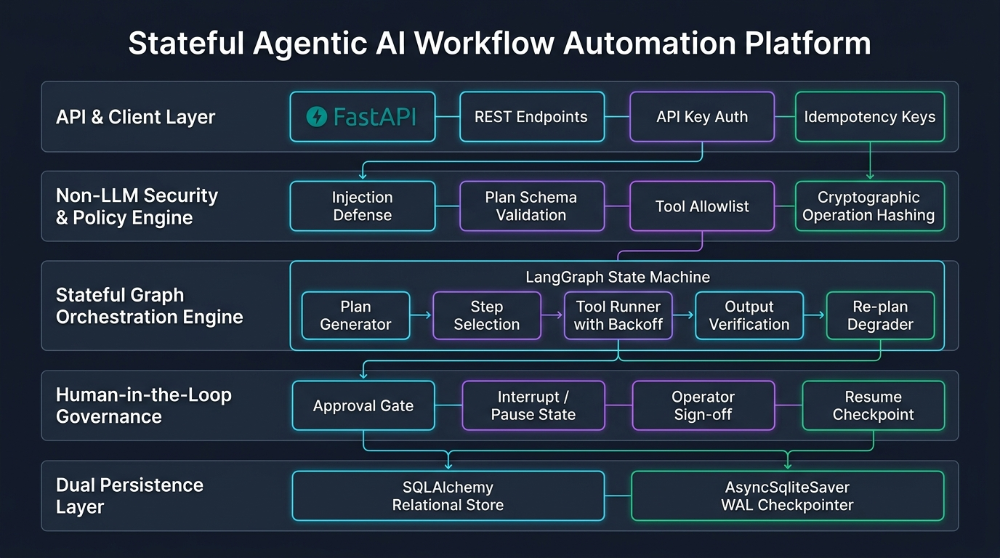
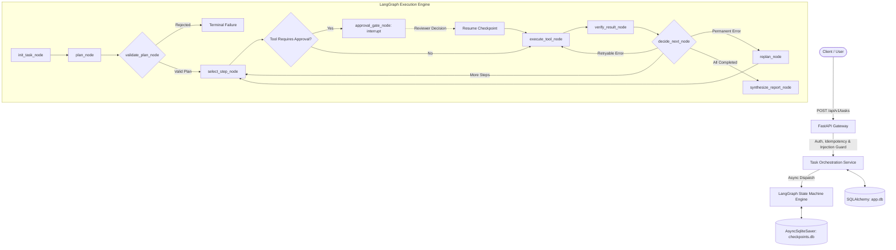

# Agentic AI Workflow Automation Platform

[](https://github.com/iakhileshsoni/agentic-ai-workflow-platform)
[](https://www.python.org/downloads/)
[](https://fastapi.tiangolo.com)
[](https://langchain-ai.github.io/langgraph/)
[](https://opensource.org/licenses/MIT)

An enterprise-grade, stateful, multi-step **Agentic AI Workflow Automation Platform** built with **Python 3.13**, **FastAPI**, and **LangGraph**. Designed to run on resource-constrained local environments (Windows, 8 GB RAM, CPU-only) with local Ollama runtime and zero paid cloud API dependencies.

---

## 🌟 Key Highlights

- **Stateful Directed Acyclic Graph (DAG) Orchestration:** Multi-step workflows compiled via LangGraph with bounded retries, controlled replanning, and strict halting guarantees.
- **Deterministic Pre-Execution Policy Engine:** Non-LLM security enforcement that statically validates step counts, DAG circularity, authorized tools, and argument schemas before invocation.
- **Human-in-the-Loop (HIL) Approval Gates:** Decoupled approval life-cycle for sensitive tools using LangGraph `interrupt()` and cryptographic operation hashing (`sha256(task_id:tool:args)`).
- **Dual Persistence Architecture:** SQLAlchemy ORM models for business entities paired with an asynchronous SQLite WAL checkpointer (`AsyncSqliteSaver`) for crash recovery and pause/resume.
- **Offline Deterministic Fallback:** Automatically switches to a deterministic planner when local Ollama is offline, guaranteeing 100% test reproducibility.
- **20-Scenario Evaluation Suite:** Empirical benchmark measuring task success, tool selection accuracy, policy rejection rate, and latency.

---

## 🏗️ System Architecture

<p align="center">
  
</p>



---

## 📊 Evaluation Benchmark Results

The platform includes an automated 20-scenario benchmark suite (`tests/evaluation/scenarios.json` and `scripts/run_evals.py`):

| Evaluation Metric | Measured Result | Benchmark Standard |
| :--- | :--- | :--- |
| **Total Scenarios Evaluated** | **20 / 20** | $\ge 20$ Scenarios |
| **Task Success / Pass Rate** | **100.0%** | $\ge 95.0\%$ |
| **Tool Selection Accuracy** | **100.0%** | Zero hallucinations |
| **Policy Violation Rejection Rate** | **100.0%** | Zero unauthorized execution |
| **Approval Gate Enforcement** | **100.0%** | Zero bypass permitted |
| **Prompt Injection Defense** | **100.0%** | Delimiter overrides sanitized |
| **Average Workflow Latency** | **125.83 ms** | Sub-second local response |

---

## 🚀 Quickstart Guide

### 1. Prerequisites
- Windows 10/11 with PowerShell
- Python 3.13+
- (Optional) [Ollama](https://ollama.com) running `qwen2.5:3b-instruct`

### 2. Setup Virtual Environment
```powershell
cd "d:\Google Prep\GenAI Projects\agentic-ai-workflow-platform"
python -m venv .venv
.\.venv\Scripts\Activate.ps1
pip install -r requirements.txt
```

### 3. Launch Development Server
```powershell
uvicorn app.main:app --host 127.0.0.1 --port 8000 --reload
```
Open **`http://127.0.0.1:8000/docs`** to access the interactive Swagger documentation.

### 4. Run Automated Tests
```powershell
# Run full Pytest test suite (40 tests):
pytest -v

# Run the 20-scenario benchmark runner:
python scripts/run_evals.py
```

---

## 🌐 API Reference

| Method | Endpoint | Description |
| :--- | :--- | :--- |
| `GET` | `/api/v1/health` | Liveness probe verifying process health |
| `GET` | `/api/v1/ready` | Readiness probe verifying DB, checkpointer, and Ollama status |
| `POST` | `/api/v1/tasks` | Ingest new multi-step agent task (supports `Idempotency-Key`) |
| `GET` | `/api/v1/tasks/{id}/status` | Lightweight status polling endpoint |
| `GET` | `/api/v1/tasks/{id}` | Comprehensive task detail with plan and completed steps |
| `GET` | `/api/v1/tasks/{id}/trace` | Chronological execution trace with per-node duration |
| `POST` | `/api/v1/tasks/{id}/cancel` | Cooperatively cancel an in-flight or paused task |
| `GET` | `/api/v1/reports/{id}/markdown`| Download synthesized Markdown report |
| `GET` | `/api/v1/approvals` | List pending approval requests awaiting human sign-off |
| `GET` | `/api/v1/approvals/{id}` | Inspect proposed tool arguments, operation hash, and risk level |
| `POST` | `/api/v1/approvals/{id}/decision`| Submit `APPROVED` or `REJECTED` decision and resume workflow |

---

## 📂 Repository Structure

```
agentic-ai-workflow-platform/
├── app/
│   ├── api/v1/               # FastAPI controllers (tasks, approvals, reports, health)
│   ├── core/                 # Config, logging, domain exceptions, security
│   ├── db/                   # SQLAlchemy declarative models & async session factory
│   ├── graph/                # LangGraph nodes, edges, state schema, and checkpointer
│   ├── planning/             # Structured planner service & Ollama adapter
│   ├── policies/             # Deterministic plan policy & prompt injection guards
│   ├── repositories/         # Task & approval database operations
│   ├── services/             # Task orchestration & approval resumption service
│   ├── tools/                # Typed tool registry & offline implementations
│   └── main.py               # FastAPI entrypoint and lifespan manager
├── data/
│   ├── fixtures/             # Vector database and technical benchmark ground truth
│   └── evaluation_report.json# Latest 20-scenario benchmark results
├── docs/                     # Architecture, security model, and migration guides
├── scripts/                  # Standalone benchmark runner (run_evals.py)
├── tests/                    # Unit, integration, API, security, and evaluation suites
├── Dockerfile                # Multi-stage production container
└── docker-compose.yml        # Multi-container orchestration
```

---

## 🛡️ License

This project is licensed under the MIT License.
