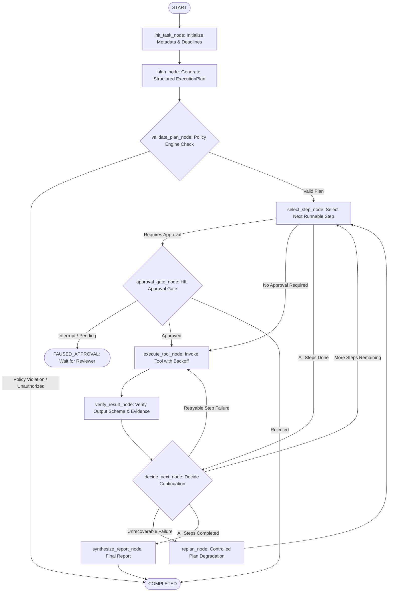

# System Architecture & Technical Specification

The **Agentic AI Workflow Automation Platform** is an enterprise-grade, stateful orchestration framework designed for bounded, verifiable, multi-step LLM operations. Unlike simple prompt chaining or single-tool execution loops, this platform enforces explicit state machines, non-LLM security gates, durable checkpointer storage, and Human-in-the-Loop (HIL) approval controls.

---

## 1. Core Architectural Tenets

1. **State Machine Containment:** All execution transitions follow a strictly typed Directed Acyclic Graph (DAG) state machine compiled via **LangGraph**. The model never loops autonomously without bound.
2. **Deterministic Security Pre-Validation:** LLM plans are treated as untrusted proposals. Plans are statically checked by the `PlanPolicyEngine` before any tool is invoked.
3. **Dual-Tier Persistence:**
   - **Application Business Store (SQLite/SQLAlchemy):** Persists tasks, execution metadata, audit events, idempotency keys, and approval requests for external querying and reporting.
   - **Execution Checkpoint Store (`AsyncSqliteSaver`):** Persists exact graph thread frames for pause/resume, time-travel debugging, and process restart recovery.
4. **Offline Local First:** Designed to run with Ollama on commodity hardware (8 GB RAM, CPU-only) with seamless, zero-downtime fallback to deterministic planning mocks for automated CI/CD and offline demonstrations.

---

## 2. Graph State Machine Topology

---

## 3. Node Responsibilities

| Node Identifier | Function | Failure Behavior |
| :--- | :--- | :--- |
| `init_task_node` | Sets initial state, initializes counters, records deadline | Fails immediately if deadline is already past |
| `plan_node` | Calls local LLM or fallback deterministic planner to produce typed `ExecutionPlan` | Fails if model output cannot be parsed |
| `validate_plan_node` | Validates step budget ($\le 8$), tool registry membership, argument schemas, DAG circularity | Direct terminal failure on policy violation |
| `select_step_node` | Topological dependency resolver: picks next step whose dependencies are satisfied | Routes to `decide_next_node` if no runnable step remains |
| `approval_gate_node` | Emits approval request in database, sets status `PAUSED_APPROVAL`, calls `interrupt()` | Pauses execution until reviewer decides |
| `execute_tool_node` | Resolves placeholder templates (`{{step_1.databases}}`), invokes tool, records timing | Retries up to `tool.max_retries` with exponential backoff |
| `verify_result_node` | Validates tool output against Pydantic `output_schema`, extracts verified evidence | Flags step as `FAILED` on schema mismatch |
| `replan_node` | Controlled degradation: skips permanently failed steps to allow independent downstream steps | Bounded by `max_replans` (default 2) |
| `decide_next_node` | Evaluates retry status, step completion status, replan triggers, or termination | Transitions to `COMPLETED` or `FAILED` |
| `synthesize_report_node` | Aggregates verified evidence into the final executive Markdown report | Always yields grounded summary |

---

## 4. Checkpoint State vs Domain Database

| Dimension | Application Database (SQLAlchemy) | Graph Checkpointer (`AsyncSqliteSaver`) |
| :--- | :--- | :--- |
| **Storage Engine** | SQLite (`data/app.db`) | SQLite in WAL mode (`data/checkpoints.db`) |
| **Primary Key** | Task ID (UUID) | Thread ID (`configurable.thread_id = task_id`) |
| **Granularity** | Task, Step, Approval, Audit entities | Complete binary state frames per graph step |
| **Access Pattern** | High-throughput REST API queries, filtering, reporting | Resume checkpoint, rollback, state replay |
| **Sensitive Data** | Minimal, sanitized payloads | Graph memory (scrubbed of secrets) |
